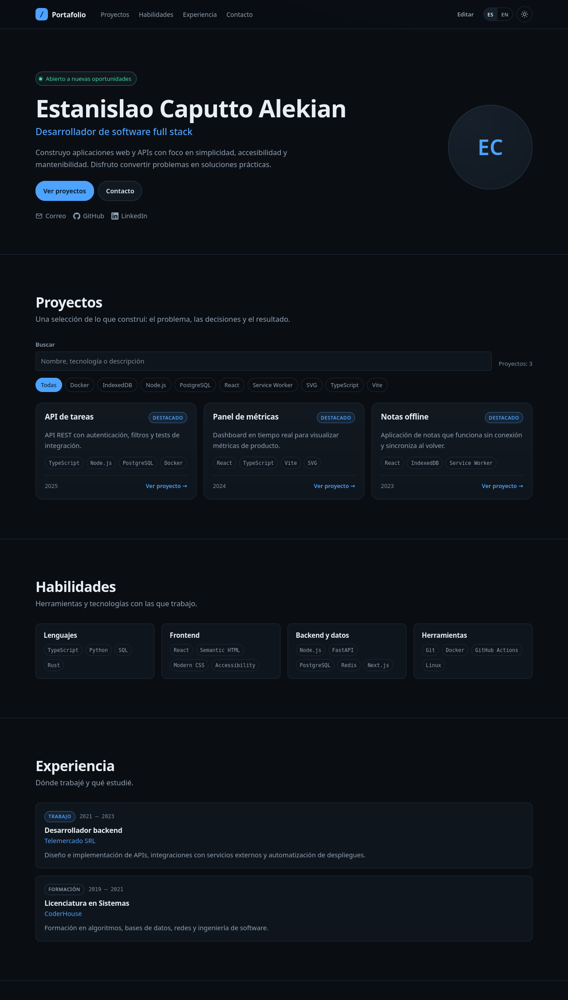

# Portafolio

Portafolio profesional bilingüe (español/inglés) de Estanislao Caputto Alekian, construido sobre una
plantilla genérica que cada persona completa con sus datos. SPA con tema oscuro por defecto y datos
en JSON, pensada para que la lean personas y también sistemas automáticos de selección.



## Stack

- **React 19 + TypeScript** con **Vite**.
- CSS propio con tokens y tema claro/oscuro (sin framework de estilos).
- i18n propia, tipada, sin dependencias.
- **Vitest + Testing Library** para tests.
- Sin backend, sin analytics: 100% estático.

## Requisitos

- Node.js **22.12+, 24 o 26+** (probado con Node 26).
- npm 10 o superior.

## Puesta en marcha

```bash
npm install
npm run dev
```

Abrí la URL que imprime Vite (por defecto `http://localhost:5173`).

## Comandos

| Comando             | Qué hace                                             |
| ------------------- | ---------------------------------------------------- |
| `npm run dev`       | Servidor de desarrollo con recarga en caliente       |
| `npm run build`     | Typecheck + build de producción en `dist/`           |
| `npm run preview`   | Sirve el build localmente                            |
| `npm run lint`      | ESLint                                               |
| `npm run typecheck` | TypeScript sin emitir                                |
| `npm test`          | Suite de Vitest                                      |
| `npm run format`    | Prettier sobre todo el proyecto                      |
| `npm run check`     | Lint + tipos + tests + build (lo mismo que corre CI) |

## Completar tus datos

1. Abrí `/#/editar` (botón **Editar** en el header).
2. Completá identidad, proyectos, habilidades y experiencia. Se guarda automáticamente en
   `localStorage` de tu navegador; **nada se sube a un servidor**.
3. Opcional: en el paso **Identidad**, importá tu perfil público de GitHub. Trae nombre, bio,
   ubicación, avatar y repositorios (los forks y archivados se descartan).
4. En **Revisar**, descargá `portfolio.json`.
5. Reemplazá `src/data/seed.json` con ese archivo y volvé a compilar/publicar.

Este repositorio ya tiene los datos publicados del autor en el seed. Para usarlo como plantilla,
reemplazá `src/data/seed.json` por el JSON de tus datos. Si un seed lleva `"demo": true`, el sitio
muestra un aviso de datos de ejemplo hasta el primer cambio.

> **LinkedIn:** no existe API pública de perfiles y scrapearlos viola sus términos. Por eso LinkedIn
> y el email se cargan como enlaces/datos manuales; solo GitHub se importa automáticamente.

## Publicar en GitHub Pages

1. Subí el proyecto a un repositorio de GitHub.
2. En **Settings → Pages → Source**, elegí **GitHub Actions**.
3. Cada push a `main` ejecuta `.github/workflows/deploy.yml`, que corre los tests y publica `dist/`.

`vite.config.ts` usa `base: './'`, así que el sitio funciona tanto en `usuario.github.io` como en
`usuario.github.io/portafolio/` sin cambios. El deploy también genera `/portfolio.json` (ver abajo).

## Rutas

| Ruta             | Contenido                                          |
| ---------------- | -------------------------------------------------- |
| `#/`             | Portafolio completo                                |
| `#/proyectos`    | Sección de proyectos                               |
| `#/proyecto/:id` | Detalle de un proyecto (enlace estable)            |
| `#/datos`        | JSON del portafolio actual, copiable y descargable |
| `#/editar`       | Asistente de carga de datos                        |

Las rutas usan hash a propósito: GitHub Pages no necesita rewrites ni `404.html`.

## Idiomas

Español (`es`) e inglés (`en`) son obligatorios y el test de i18n falla si a alguno le falta una
clave. Para agregar un idioma:

1. Creá `src/i18n/<código>.ts` con `Record<TranslationKey, string>` (copiá `en.ts` como base).
2. Sumalo a `dictionaries`, `localeNames` y `localeShortNames` en `src/i18n/index.ts`.
3. Los textos de contenido (`headline`, `bio`, `summary`…) aceptan cualquier código de idioma; el
   asistente muestra automáticamente un campo por idioma registrado.
4. Los tests validan que todas las claves estén traducidas y no vacías.

## Para revisores humanos y automáticos

- **HTML semántico** con jerarquía de encabezados, `landmarks`, enlaces estables y navegación por
  teclado; foco visible y contraste AA.
- **JSON-LD** `schema.org/Person` en el `<head>` con nombre, puesto, bio, email, enlaces y skills.
- **`/portfolio.json`**: archivo estático generado en cada build desde el seed, útil para
  procesamiento automático sin ejecutar JavaScript.
- **`/llms.txt`**: guía breve del sitio y del formato de datos para modelos de lenguaje.
- **`#/datos`**: vista legible del JSON con botones para copiar y descargar.
- **Impresión / PDF**: `Ctrl+P` oculta navegación y aplica un estilo limpio tipo CV.

## Limitaciones conocidas

- La importación de GitHub consulta su API pública sin token: **60 solicitudes/hora por IP** y 2 por
  importación. Si se agota, la app lo informa y podés seguir cargando datos a mano.
- Los datos editados viven en tu navegador; publicarlos requiere exportar el JSON y reemplazar el
  seed (paso 5).
- Al ser una SPA con hash, el HTML inicial no contiene los datos de la persona; `/portfolio.json` y
  `llms.txt` cubren a los lectores que no ejecutan JavaScript.

## Estructura

```
portafolio/
├── src/
│   ├── App.tsx                 # rutas y estado del portafolio
│   ├── components/             # UI de la SPA y asistente
│   │   └── wizard/             # pasos del onboarding
│   ├── data/                   # tipos, seed, normalización y storage
│   ├── i18n/                   # diccionarios ES/EN y provider
│   ├── lib/                    # github, rutas, jsonld, url, slugs
│   └── styles/                 # tokens, base y componentes CSS
├── public/                     # favicon, llms.txt, robots.txt
├── scripts/export-data.mjs     # genera public/portfolio.json desde el seed
├── docs/adr/                   # decisiones de arquitectura
└── .github/workflows/          # CI y deploy a GitHub Pages
```

## Decisiones de arquitectura

Ver [`docs/adr/0001-arquitectura-base.md`](docs/adr/0001-arquitectura-base.md).
